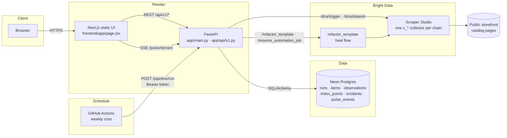
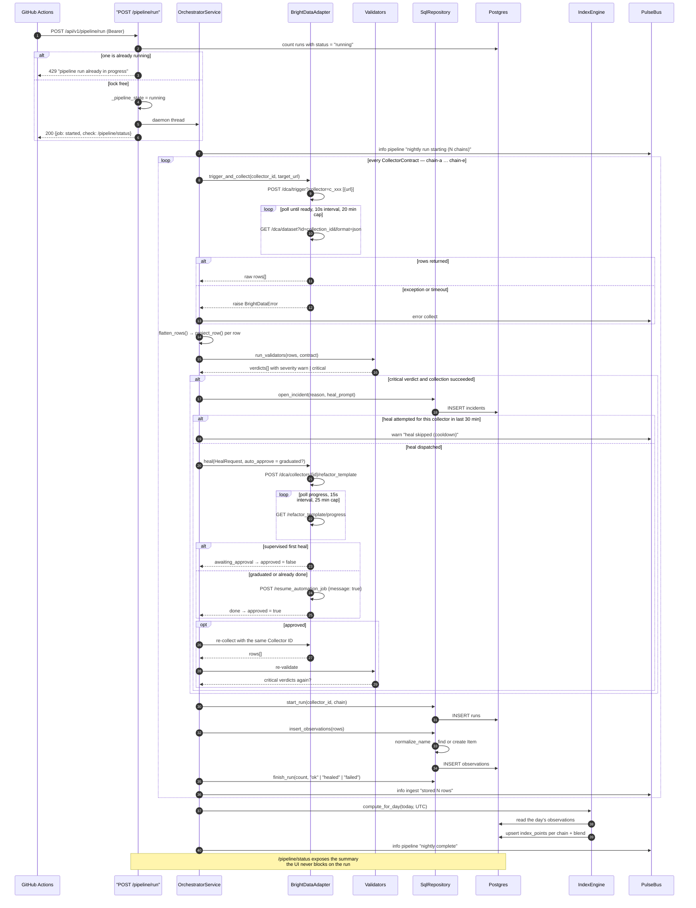
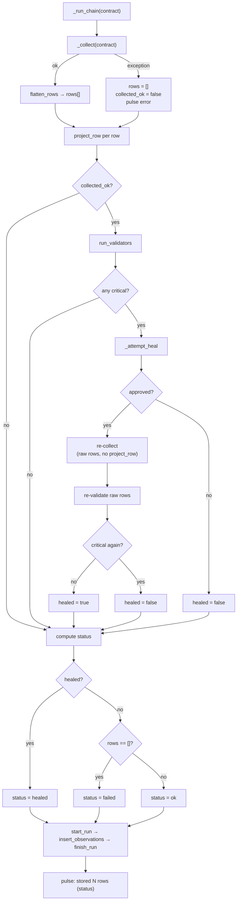
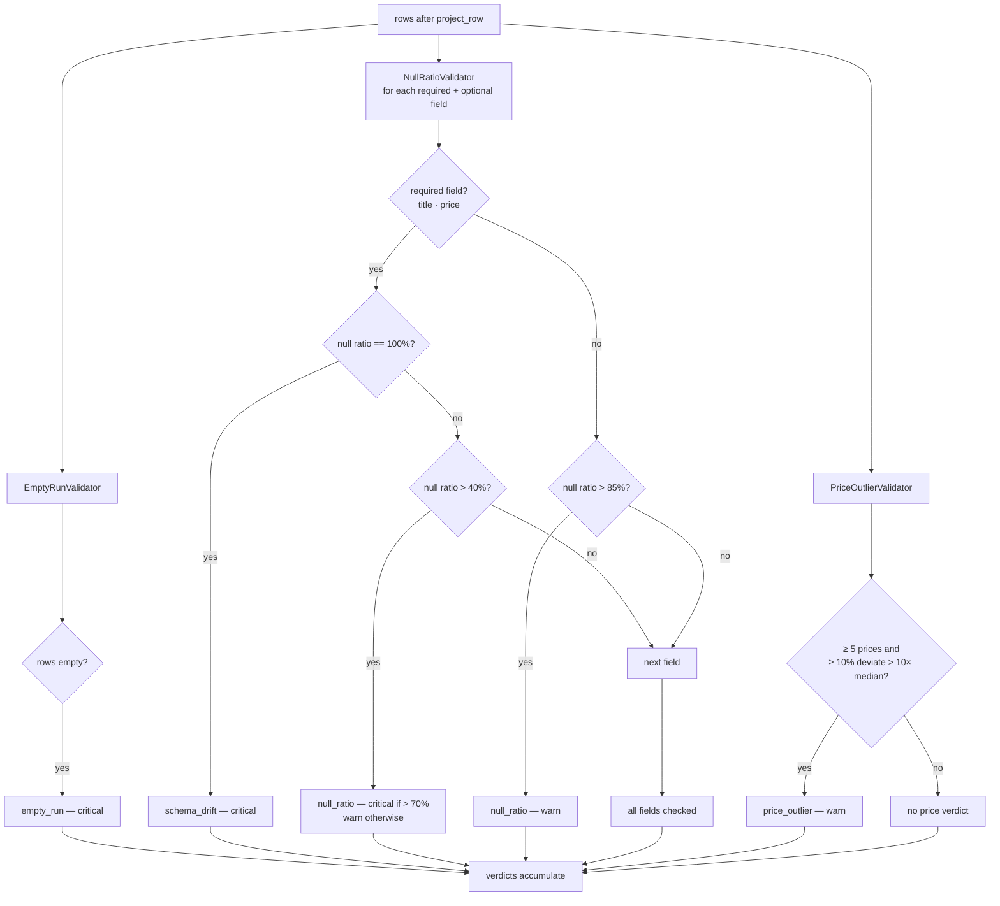
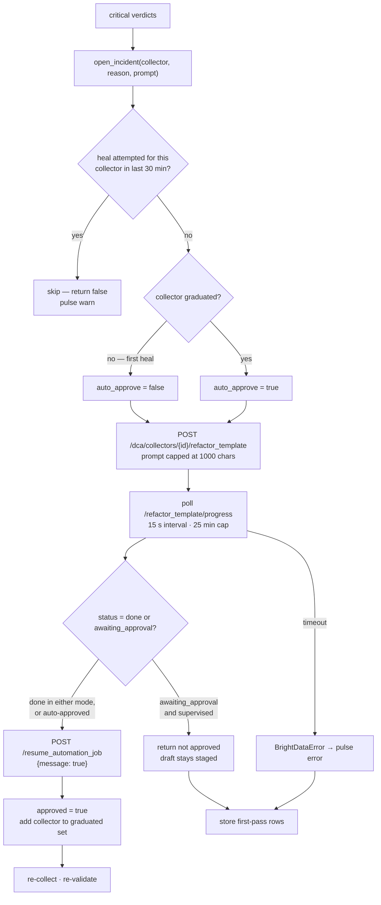
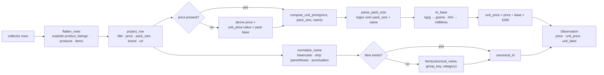
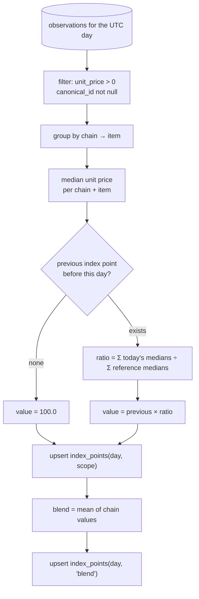
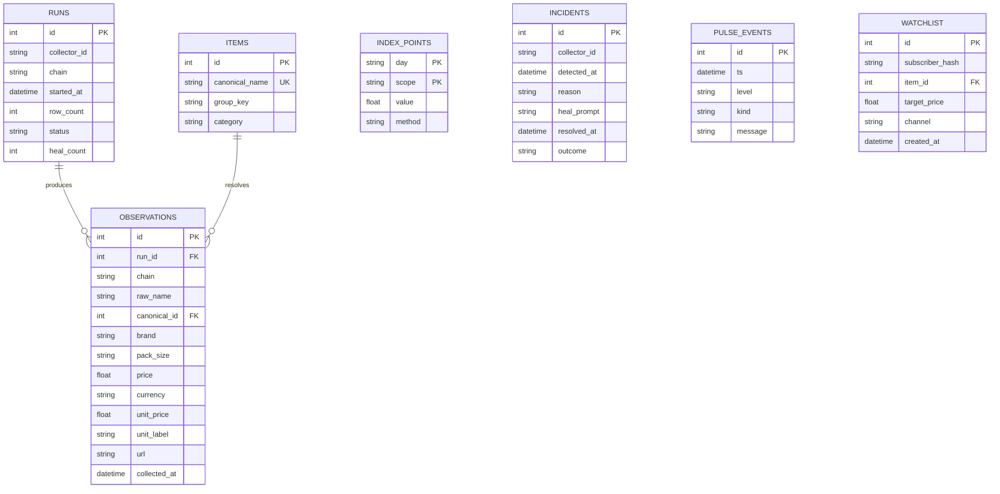
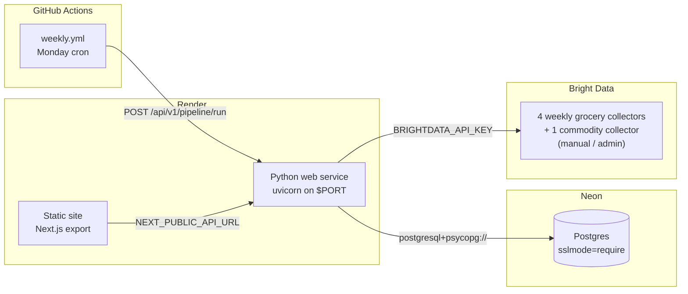

# Mehngai — end-to-end flow

This document traces the system the way the code actually runs it: one weekly
collection, one index computation, and one page load. Every box names the file
and function that owns that step, so the diagram can be checked against the
source rather than trusted.

Three loops make up the product:

1. **Collection loop** — cron → collectors → validators → heal → observations.
2. **Index loop** — observations → medians → chained index points.
3. **Read loop** — API queries → dashboard (plus the SSE pulse).

---

## 0. What the product is, in one picture

```mermaid
flowchart LR
    SH["Storefront catalog pages<br/>4 grocery chains + gold/fuel"] --> COL["Bright Data Scraper Studio<br/>one collector per chain"]
    COL --> RAW["raw rows<br/>collector-specific schema"]
    RAW --> FLAT["flatten_rows"]
    FLAT --> PROJ["project_row<br/>title · price · pack_size · brand · url"]
    PROJ --> VAL{"run_validators<br/>empty · null · outlier"}
    VAL -->|"critical"| HEAL["_attempt_heal<br/>refactor_template → approve"]
    HEAL -->|"approved: re-collect"| VAL
    VAL -->|"warn or clean"| NORM["to_observations<br/>compute_unit_price<br/>find or create Item"]
    HEAL -->|"not approved:<br/>keep first-pass rows"| NORM
    NORM --> OBS[("observations<br/>append-only")]
    OBS --> IDX["IndexEngine.compute_for_day<br/>chained Laspeyres"]
    IDX --> IP[("index_points<br/>one per chain + blend")]
    OBS --> READ["/api/v1 read models<br/>prices · basket · deals<br/>movements · inflation · stats"]
    IP --> READ
    READ --> UI["dashboard<br/>index hero · basket matrix<br/>deal radar · movement ticker"]
    OBS --> PULSE["PulseBus → SSE"]
    PULSE --> UI
```



Everything the visitor sees is derived from two tables: the latest rows in
`observations` and the points in `index_points`. The collectors, the watchdog,
and the heal loop exist only to keep those two honest.

---

## 1. System context



The UI holds no state. Everything it renders is a read model computed at request
time, except the pulse feed, which is pushed over SSE.

---

## 2. The weekly run, end to end

Entry point: `OrchestratorService.run_nightly` in
`backend/app/services/orchestrator.py`, started from
`POST /api/v1/pipeline/run` in `backend/app/api/v1.py`.



**What the caller gets back.** `POST /pipeline/run` returns immediately with
`{"job": "started"}`. The work happens on a daemon thread because four chains
take minutes. Progress is polled at `GET /pipeline/status`, and the summary is
also written to the pulse feed.

**Two guards, only one of them durable.** The route first asks Postgres whether
any `runs` row still has `status = "running"`, then takes a process-wide
`threading.Lock`. The database check is usually a no-op because `_run_chain`
closes each run before the next begins; the lock is what actually serialises
callers. A second caller gets `429` either way, and the GitHub workflow retries
three times at 60-second intervals to ride out a Render cold start.

**Chain identity is positional.** `contracts` walks `COLLECTOR_IDS` in order and
labels them `chain-a`, `chain-b`, … with URLs from `COLLECTOR_URLS` split on
`|`. Swapping the order of the env list swaps the identities, which is why
historical rows were migrated once with `/admin/migrate-chains`.

---

## 3. Inside one chain



`project_row` is the compatibility layer: it maps each collector's dialect
(`product_title`, `selling_price`, nested `{"value": "₹49"}` prices) onto one
schema before validation. That ordering matters. Validating raw collector
output would flag every legitimate schema difference as drift.

The post-heal pass breaks that ordering. `_collect` returns raw, flattened rows,
and the code runs `run_validators` on them directly — no second `project_row`.
A repaired collector that still speaks `product_title` / `selling_price` looks
like `schema_drift` on the retry even when the repair worked, so `healed` is
reported false and the run falls back to `ok` or `failed`. Storage is unaffected:
`to_observations` understands both dialects.

```python
# backend/app/services/orchestrator.py
def project_row(row):
    return {
        "title": _first(row, "title", "product_title", "name"),
        "price": _extract_price(row) or _derive_price_from_unit(...),
        "pack_size": _first(row, "pack_size", "pack_size_label", "weight"),
        "brand": _first(row, "brand", "brand_name"),
        "url": _first(row, "url", "product_page_url", "product_url", "link"),
    }
```

`flatten_rows` handles collectors that return a single row containing a list:
if a row has `product_listings`, `products`, or `items` and every element is a
dict, the list is exploded into individual rows. That was the Nature's Basket
repair, kept as a general adapter.

---

## 4. The drift checks, exactly

`backend/app/services/validators.py` runs three validators over the same row set.
They are independent: each returns zero or more `Verdict(kind, severity,
detail)`, and the route accumulates all of them. Nothing short-circuits.



Thresholds come from `CollectorContract` and `Settings`:

| Knob | Default | Where |
|---|---|---|
| required fields | `title`, `price` | `CollectorContract` |
| null ratio floor | `0.4` | `Settings.null_ratio_threshold` |
| schema drift | required field null on 100% of rows | `NullRatioValidator` |
| critical null ratio | `> 0.7` | `NullRatioValidator` |
| optional field warn | `> 0.85` | `NullRatioValidator` |
| price outlier | `> 10×` median, ≥ 10% of rows | `PriceOutlierValidator` |
| outlier minimum sample | 5 prices | `PriceOutlierValidator` |

Only `critical` verdicts trigger a heal. Warnings are recorded in the run and
pulse but never block ingestion. A single row set can produce several verdicts
at once: for example, `empty_run` plus a `schema_drift` for `title` and another
for `price`.

---

## 5. The heal flow as a state machine



The cooldown is per collector, not per incident, and it is written **before**
the heal is attempted:

```python
last = self._heal_cooldown.get(contract.collector_id, 0)
if now - last < 1800:
    ...return False
self._heal_cooldown[contract.collector_id] = now
```

So a failed or timed-out heal still suppresses the next attempt for 30 minutes,
and "healed within 30 min" would be the wrong reading of that branch.

The cooldown also has a boot-time edge case. `last` defaults to `0` and `now` is
`time.monotonic()`, which counts from boot. If the API process is younger than
30 minutes, `now - 0 < 1800`, so the **first** heal can be skipped as if one had
just happened. A Render cold start followed immediately by a drift detection
lands exactly in that window.

**The incident is never closed by the pipeline.** `open_incident` runs before
the cooldown check, and its returned id is discarded. `SqlRepository.
resolve_incident` exists but has no caller. Every drift therefore leaves an open
`incidents` row — including a cooldown-skipped run and a heal that succeeded.
The three resolved incidents visible in the shipped database were inserted by
`POST /admin/restore-history`, not by the watchdog. `/insights/daily` counts
`resolved_at IS NULL` as `incidents_open`, so that number only grows.

Heal prompts are generated, not hand-written per incident:

```python
# backend/app/services/orchestrator.py
fields = sorted({v.detail.split('"')[1] for v in critical if '"' in v.detail})
target = ", ".join(fields) or "the main fields"
prompt = (
    f"The scraper for {chain} started returning empty/null values for {target} "
    f"since the site layout changed. Re-capture these fields from the current markup "
    f"while keeping the exact same output schema."
)[:1000]
```

Two properties make this safe to automate. The `Collector ID` is preserved
through the repair, so the trigger URL, the contract, and every downstream row
stay valid. And the first heal per collector is supervised: the template arrives
as a draft and only `resume_automation_job` puts it into production. After one
verified approval the collector joins `_graduated` and subsequent heals run
unattended.

Both `_graduated` and `_heal_cooldown` are in-process dictionaries. A restart
resets them: the next heal is supervised again, and the cooldown is forgotten.
That is a deliberate simplicity trade for a single-instance deployment, and it is
the first thing to externalise if the API is ever scaled out.

---

## 6. Row to observation: identity and unit prices



`to_observations` owns the left branch; `SqlRepository.insert_observations` →
`_ensure_item` owns the right branch. On the post-heal path `project_row` is
skipped, so a row that only carries a nested `unit_price.value` has no price to
derive from and is dropped by `to_observations`.

Worked example: ₹49 for 500 g.

```
parse_pack_size("500 g") → amount 500, unit "g"
to_base(500, "g")        → 500 grams, "per kg"
unit_price               → 49 / 500 × 1000 = ₹98/kg
```

`group_key` is the pack-agnostic identity used to recognise the same product at
two stores:

```python
"Amul Butter 500 g"  → "amul butter"
"Amul Butter 1 kg"   → "amul butter"
"Amul Butter 500g"   → "amul butter"
```

It strips sizes (`500 g`, `1 kg`, `200 ml`), counts (`2 x 100 g`), and retail
noise (`pack of 3`, `combo`, `offer`). `canonical_name` stays exact so the
price explorer can still distinguish a 500 g pack from a 1 kg pack.

---

## 7. The index computation

`IndexEngine.compute_for_day(day)` in
`backend/app/services/index_engine.py` runs once per pipeline, after every
chain has been stored.



The reference price is the first **ingested** observation for that
chain + item, selected by the lowest `Observation.id` — not by `collected_at`,
and not by the first day of the current window. For weekly grocery runs the two
orderings coincide. For the commodity backfill, which inserts source rows in
whatever order the source table returns, they may not: `_base_price` can pick a
recent date as the base. That is a real source of distortion in the gold series.

```
index(t) = index(t-1) × ( Σ median_unit_price(t) / Σ reference_price )
```

Only items with both a reference price and a current median enter either sum, so
one store dropping an item does not silently deflate the ratio. The method
string stored with every point is `chained-laspeyres`.

---

## 8. What each read computes

All routes live in `backend/app/api/v1.py`. Reads never write except the admin
and pipeline endpoints.

| Endpoint | Auth | Reads | Computed by |
|---|---|---|---|
| `GET /health` | – | `SELECT 1` | route |
| `GET /chains` | – | config | `core/chains.chain_meta` |
| `GET /index` | – | `index_points` | `IndexEngine.series` (last `days × 8` rows) |
| `GET /prices?q=` | – | `items`, `observations`, `runs` | route, fuzzy match + latest per chain, no freshness cutoff |
| `POST /basket` | – | same, last 36 h | route, per-store pack-price totals |
| `GET /deals` | – | last 36 h, ≥ 2 chains | route, effective-price gap ≥ 3% |
| `GET /stats` | – | `items`, `observations`, `runs` | route, counts |
| `GET /movers` | – | `index_points` | route, first vs last per chain, blend excluded |
| `GET /inflation` | – | `observations`, `items` | route, medians per day |
| `GET /movements` | – | last 36 h, ≥ 2 readings | route, unit or pack basis |
| `GET /incidents` | – | `incidents` | route |
| `GET /pulse/stream` | – | in-process bus | `PulseBus` + SSE |
| `GET /pulse/recent` | – | bus buffer | `PulseBus.recent` |
| `GET /insights/daily` | – | `index_points`, `incidents`, `observations` | `InsightsService` |
| `GET /pipeline/status` | – | process dict | route |
| `POST /pipeline/run` | Bearer | writes via orchestrator | `OrchestratorService` |
| `POST /admin/*` | Bearer | maintenance | routes |

Four of these deserve their exact rules, because they are easy to misread:

**`/inflation`** does not read `index_points`. It takes the distinct scan days,
uses the **first-ever** and latest, computes a median unit price per item on
each day, intersects the item sets, and converts each shared item to a
percentage change. It is not a rolling 30-day window. Items are bucketed by the
run chain of one observation: `commodities*` becomes gold or fuel depending on
the raw name, `chain-*` becomes groceries. The headline is the **median of the
live category averages**, not the average of all items. Groceries and fuel
always get a chip; if either has no comparable second reading it reports
`status: baseline_today` and `change_pct: null`. Gold & Silver only appears when
it has live deltas.

**`/basket`** only declares a winner among stores with **full coverage** of the
requested items; partial stores are shown but excluded. It also computes
`smart_total` (the cheapest price per line, summed) and `spread` (the
line-by-line worst available price minus the smart mix, summed — not one
store's total). If fewer than two stores have full coverage there is no winner.
When no line has prices from two stores, the note picks `max(totals)` while
calling it the cheapest; with a one-store basket those are the same store, but
with disjoint coverage it can name the wrong one.

**`/deals`** chooses the **effective** price per store: unit price when
available, pack price otherwise. The choice is made per chain, not per item, so
a store with a pack size can be compared on ₹/kg against one without it on pack
price. That produces a large, meaningless gap; the shipped grocery data mostly
avoids it because those rows carry pack sizes. A deal also needs a gap of at
least 3% and a high price of at least ₹20, so a ₹2 difference on a ₹10 item does
not top the radar.

**`/movements`** compares the earliest and latest reading of the same item at
the same store inside the 36-hour freshness window, refuses to mix bases (unit
vs pack) unless the pack strings match exactly, and drops any change above 60%
as a listing change rather than a repricing. It reads at most 5,000 observations
before grouping.

**`/prices`** is the exception to the freshness rule: it returns the latest
observation per chain from the 400 most recent matching rows, with no date
cutoff. A stalled pipeline shows old prices here while basket/deals/movements
show nothing.

---

## 9. Data model



`observations` is append-only. Corrections never update a row; a new run appends
new observations, and `collected_at` decides which one a read considers current.
`runs` is the audit trail of collection attempts, not of price truth. `index_points`
is a materialised read model: safe to delete and recompute from observations.

Two parts of the schema are placeholders from the design, not live features:
`runs.heal_count` is never incremented, and `watchlist` has no writer and no
route in the shipped code. `SqlRepository.resolve_incident` is implemented but
has no caller.

---

## 10. Deployment topology



The adapter normalises `postgresql://` to `postgresql+psycopg://` in
`core/db.py`, because SQLAlchemy otherwise assumes psycopg2 while the
deployment installs psycopg 3. The API runs as a single instance, which is what
makes the in-process lock, cooldown, and graduation set coherent. On Render's
free tier the service sleeps when idle; the Monday cron's first request can take
~40 seconds to wake it, which is why the workflow retries three times.

---

## 11. Code map

| File | Responsibility | Key symbols |
|---|---|---|
| `app/main.py` | app factory, CORS, durable pulse sink | `create_app`, `_durable_sink` |
| `app/api/v1.py` | every HTTP route and read model | `basket`, `inflation`, `deals`, `movements`, `pipeline_run` |
| `app/api/deps.py` | DI and auth | `get_db`, `get_scraper`, `require_pipeline_token` |
| `app/services/orchestrator.py` | the weekly loop | `run_nightly`, `_run_chain`, `_attempt_heal`, `project_row`, `flatten_rows` |
| `app/services/validators.py` | drift detection | `EmptyRunValidator`, `NullRatioValidator`, `PriceOutlierValidator` |
| `app/services/normalizer.py` | units and identity | `parse_pack_size`, `to_base`, `compute_unit_price`, `normalize_name`, `group_key` |
| `app/services/index_engine.py` | chained index | `compute_for_day`, `_ratio`, `_base_price` |
| `app/services/pulse.py` | event bus + buffer | `PulseBus.emit`, `subscribe`, `recent` |
| `app/services/insights.py` | daily briefing | `build_facts`, `daily_briefing` |
| `app/adapters/brightdata.py` | Scraper Studio REST | `trigger_and_collect`, `heal`, `_poll_dataset` |
| `app/adapters/mock_scraper.py` | offline development | `MockScraperAdapter` |
| `app/adapters/repository_sql.py` | persistence port | `start_run`, `insert_observations`, `_ensure_item` |
| `app/domain/models.py` | schema | six tables |
| `app/core/config.py` | typed env | `Settings` |
| `app/core/db.py` | engine, sessions, dialect fix | `session_scope`, `init_db` |
| `scripts/backfill_commodities.py` | gold/fuel history | `run_ingest` |
| `frontend/lib/api.js` | API client | `api.*`, `openPulseStream` |
| `frontend/app/page.jsx` | dashboard | hero, matrix, radar, pulse |

---

## 12. Where the code diverges from the happy path

These are real behaviours worth knowing before debugging a run:

1. **Incidents are opened, never closed.** `_attempt_heal` calls `open_incident`
   before the cooldown check and discards the returned id. `resolve_incident`
   exists but has no caller. A skipped heal, a failed heal, and a successful
   heal all leave `resolved_at = null`. The three resolved rows in the shipped
   database came from `POST /admin/restore-history`, not the watchdog.
2. **A failed post-heal validation is stored as `ok`.** The run status describes
   whether rows arrived, not whether they are trustworthy.
3. **Post-heal validation skips `project_row`.** `_collect` returns raw rows and
   `run_validators` sees them directly. A collector that still uses
   `product_title` / `selling_price` fails the retry even after a successful
   repair, so `healed` is false and status falls back to `ok`. A raw row that
   only carries a nested `unit_price.value` also loses its derived pack price
   and is dropped by `to_observations`.
4. **`_graduated` and `_heal_cooldown` are process memory.** A redeploy resets
   both. The next heal for every collector is supervised again.
5. **The cooldown can skip the first heal after a cold start.** It stores
   `time.monotonic()` and defaults to `0`; on a process younger than 30 minutes
   the first drift looks like a recent attempt.
6. **A supervised heal does not retry.** If the template lands in
   `awaiting_approval`, the original rows are ingested and the next weekly run
   decides again. That is intentional: a human should look at a first-time
   structural change.
7. **Chain slugs are positional.** `chain-a` means "first collector in
   `COLLECTOR_IDS`", not "Nature's Basket". Reordering the env list re-labels
   the fleet.
8. **Two different index paths exist.** `index_points` is written by the
   pipeline; `/inflation` recomputes from observations per request. They share
   raw rows, not code, and can differ in scope labels and rounding.
9. **Reads are freshness-bounded — except `/prices`.** Basket, deals, and
   movements ignore anything older than 36 hours; prices does not. A stalled
   pipeline makes most of the dashboard say "not on today's shelves" while the
   search box still returns old rows.
10. **Commodities are a separate writer with a shared index step.**
    `run_ingest` deletes and rebuilds its own observations, runs, and
    `commodities%` index points, and fixes the true source dates rather than
    using ingestion time. The weekly orchestrator does not collect commodities,
    but it calls the same `compute_for_day`, so a run on a day that has
    commodity observations will also write points for those chains.
11. **The index base is first-by-id, not earliest-by-date.** `_base_price` picks
    the lowest `Observation.id`. For weekly grocery runs ingestion order and
    date order coincide; for the commodity backfill, which inserts rows in
    source order, they may not. Verify the source order before trusting the gold
    series.
12. **The basket note can name the wrong store.** When no line has two prices,
    the note picks `max(totals)` but says "cheapest at …". With one store that
    is harmless; with disjoint coverage it is not.
13. **Deals can compare incompatible bases.** The effective price is chosen per
    chain, so a ₹/kg unit price can be compared against a pack price when the
    other store has no pack size. The 3% threshold does not protect against it.
14. **`runs.heal_count` and `watchlist` are placeholders.** Neither has a writer
    in the shipped code; `watchlist` has no route at all.
15. **`/index` assumes about eight scopes per day.** `series` slices the last
    `days × 8` rows. With more chains or commodity scopes, the requested window
    silently loses its oldest days.
16. **A cold DMart run can look like a regression.** The JS-rendered collector
    occasionally returns zero rows from a fresh host. That is a genuine
    `empty_run` verdict, so the watchdog opens an incident and may dispatch a
    heal for what is really a slow render. It self-corrects on the next run.

